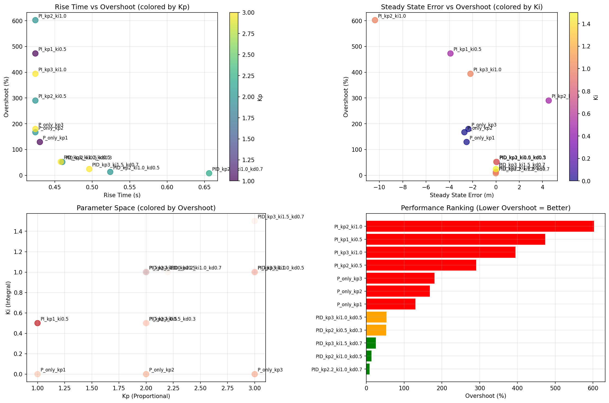
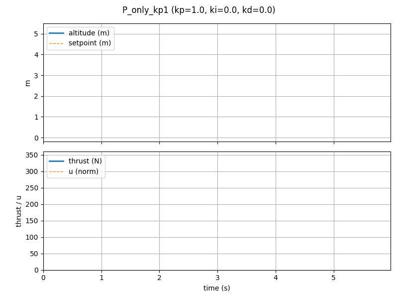
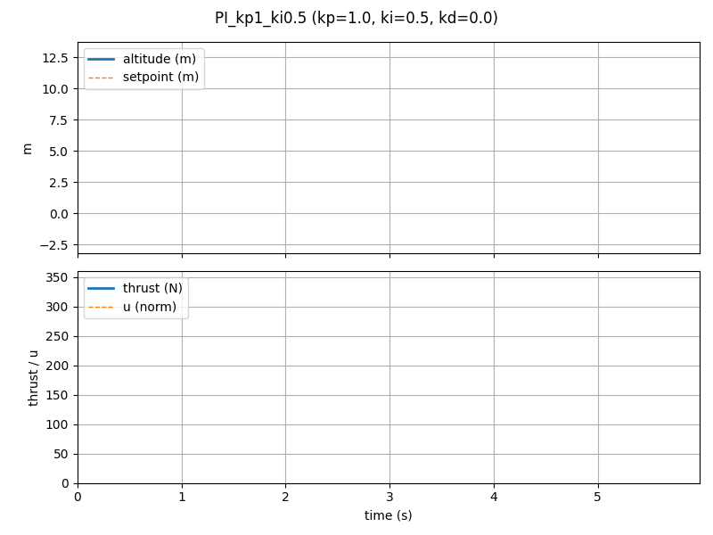
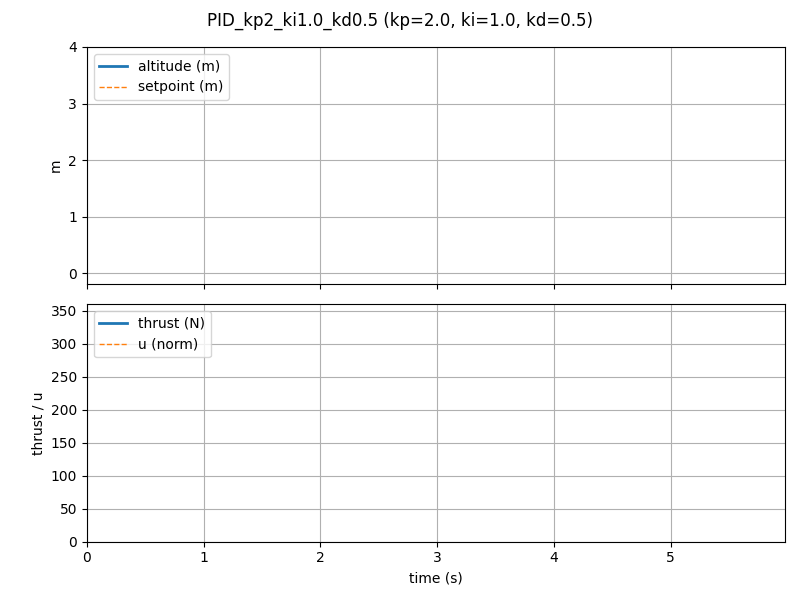
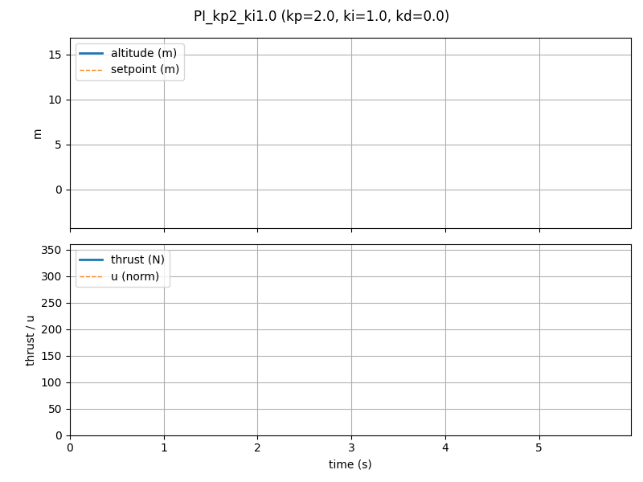
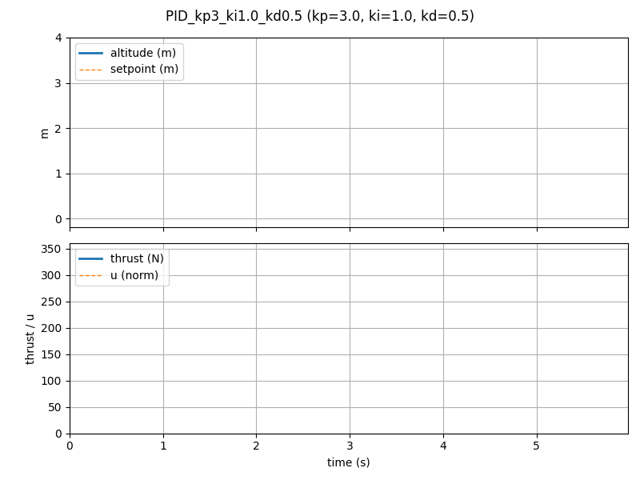
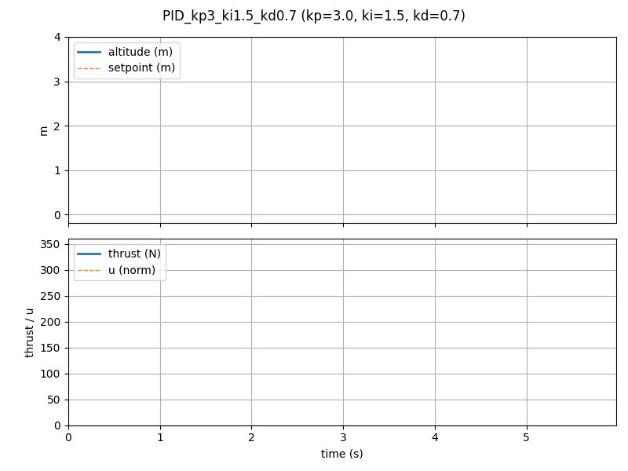
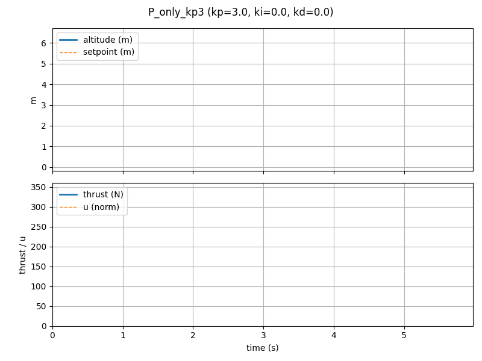

# Simulacra — Rocket Control Simulation Learning Project

This repository is a **learning playground** to become a rocket software/control expert.  
We are building up from scratch — simple, modular steps — towards full reusable rocket simulations.

## Philosophy

- **Learning first.** We prefer implementing things ourselves (RK4, PID, IMU noise, etc.) before reaching for libraries.
- **Expertise over tools.** We focus on mastering the fundamentals (RK4, PID, etc.) before using libraries.
- **Beauty and elegance.** Code should be modular, readable, and explicit. Fewer “magical” shortcuts, more clarity.
- **Step by step.** Every new feature is its own `stepXX_.../` folder, each one teaching a clear concept.
- **Rocket realism.** We start simple (point mass, vertical hop) but always design with real rocket constraints in mind (resilience, edge cases, testability).
- **Visual-first learning.** Each step includes simple plots or animations so we can “see” what’s happening.

---

## Project Structure

```

simulacra/
├── out/
│   └── grid_search/
│       └── batch_metrics.csv
│       └── P_only_kp1.png
│       └── P_only_kp2.png
│       └── P_only_kp3.png
│       └── PI_kp1_ki0.5.png
├── src/
│   └── simulacra/
│       ├── core/                 # Reusable building blocks (utils, integrators, etc.)
│       └── steps/
│           └── step01_vertical_hop/  # First milestone
│               ├── sim.py
│               └── scripts/
│                   └── pid_experiments.py
├── tests/                        # pytest tests (unit tests for each core module)
├── README.md
└── .cursor/RULES.mdc             # Cursor config: rules, preferences, and learning requirements

```

---

## Current Milestone: Step 01 — Vertical Hop

**Goal:** Simulate a rocket doing a “vertical hop” — just thrust vs gravity, up/down, no lateral motion.

### Implemented so far
- `utils.clamp` — clamp values between bounds, with `None` support.
- `integrators.rk4_step` — clean, generic Runge–Kutta 4 integrator.
- `State` class — altitude + velocity.
- `Rocket` class — parameters: mass, drag, gravity.
- `PID` controller — proportional–integral–derivative with clamping and optional integrator windup guard.
- `run_simple_sim` — step simulation with RK4 + PID.
- `animate_logs` — matplotlib animations of altitude, thrust, and control effort.
- `pid_experiments.py` script — CLI to run single sims, save animations, or sweep many configs in batch.

---

## Example Run

Single interactive simulation:

```bash
uv run python src/simulacra/steps/step01_vertical_hop/scripts/pid_experiments.py \
  --controller PID --kp 2.2 --ki 1.0 --kd 0.7 --t_final 6.0
````

Batch grid sweep with GIF outputs:

```bash
uv run python src/simulacra/steps/step01_vertical_hop/scripts/pid_experiments.py \
  --batch \
  --batch-configs "[{'name':'kp2_ki0','kp':2.0,'ki':0.0,'kd':0.0,'save_anim':'out/grid/kp2_ki0.gif'}]" \
  --outdir out/grid_results
```


### Batch Results: PID Grid Sweep

Below are example GIFs from a grid sweep of PID parameters (`kp`, `ki`, `kd`).  
Each animation shows altitude (blue), setpoint (dashed), thrust, and control effort for a single run.

All outputs are saved in `out/grid_search/`.




| Controller | `kp` | `ki` | `kd` | Animation |
|:----------:|:----:|:----:|:----:|:---------:|
| P only     | 1.0  | 0.0  | 0.0  |  |
| PI         | 1.0  | 0.5  | 0.0  |  |
| PID        | 2.2  | 1.0  | 0.7  |  |
| PID        | 2.0  | 0.5  | 0.3  |  |
| PID        | 2.0  | 1.0  | 0.5  |  |
| PI         | 2.0  | 0.5  | 0.0  |  |
| PI         | 2.0  | 1.0  | 0.0  |  |
| P only     | 2.0  | 0.0  | 0.0  |  |
| PID        | 3.0  | 1.0  | 0.5  |  |
| PID        | 3.0  | 1.5  | 0.7  |  |
| PI         | 3.0  | 1.0  | 0.0  |  |
| P only     | 3.0  | 0.0  | 0.0  |  |

> **Note:**  
> - Each GIF shows altitude (blue), setpoint (dashed), thrust, and control effort.
> - The full grid, metrics CSV, and summary plot are in `out/grid_search/`.
---

## Next Steps

* Add **IMU simulation** (accelerometer with bias and noise).
* Add **sensor fusion** basics.
* Improve **visuals**: overlay rocket sprite, error vs time plots, etc.
* Experiment with **different controllers**: LQR, model predictive control, etc.
* Eventually: move to **2D/3D**, attitude control, multiple stages.

---

## Learning Notes

* **RK4 integrator**: chosen for clarity; generic over `np.ndarray`. We wrap with `rk4_state_step` for nicer `State` API.
* **PID design**: explicit `u_min`/`u_max` for saturation, integrator clamping to avoid windup.
  Example:

  ```python
  pid = PID(kp=2.2, ki=1.0, kd=0.7, u_min=0.0, u_max=1.0, integrator_limit=8.0)
  ```
* **Tests**: all core utils and integrators covered with pytest.
  Example:

  ```bash
  pytest -v
  ```

---

## Dependencies

Minimal by design:

* `numpy`
* `matplotlib`
* `pytest` (dev only)
* `pillow` (optional, for GIF saving)

Managed with [uv](https://github.com/astral-sh/uv) (`pyproject.toml` + `uv.lock`).

---
